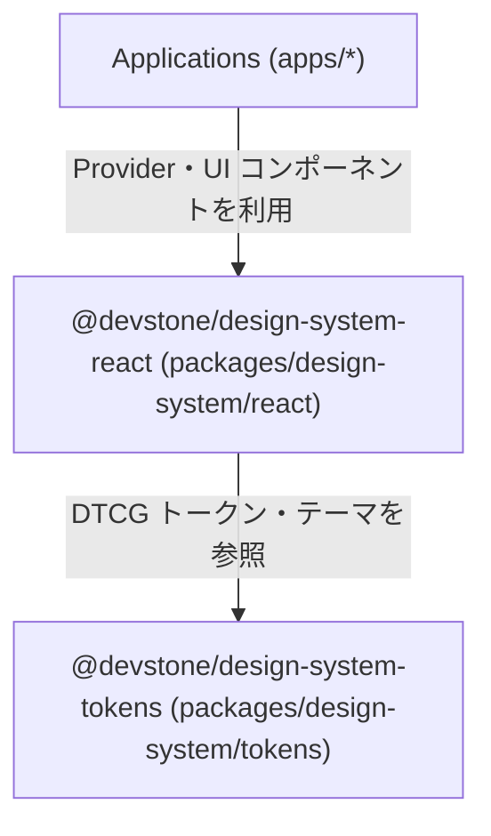
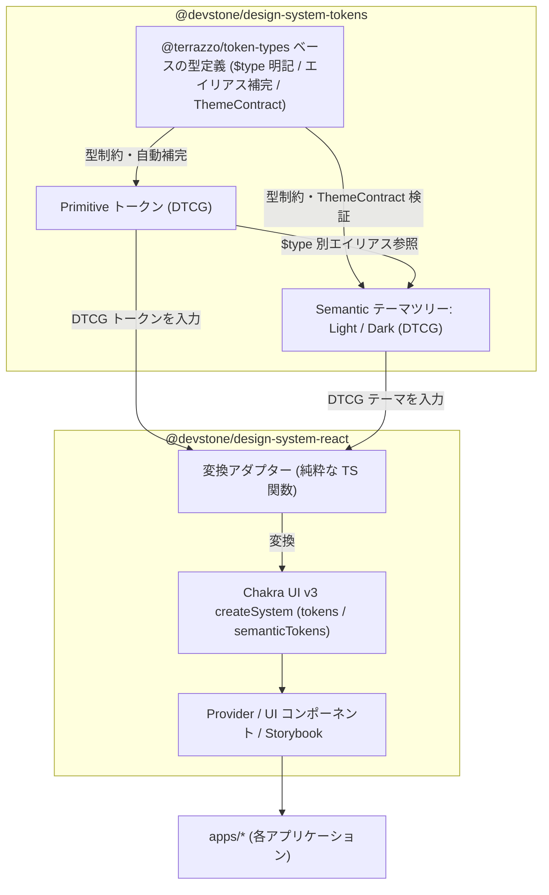

# Design System

W3C DTCG（Design Tokens Community Group）仕様と Chakra UI v3 をベースにした、
プロジェクト共通のデザインシステムです。

## 💡 設計思想

1. **Code as SSoT (真実の単一ソース)**
   デザイントークンは Figma 等の外部ツールではなく、W3C DTCG 準拠の TypeScript コードを
   一次ソース（SSoT）として管理します。
2. **型システムによる厳格なトークン制約**
   `@terrazzo/token-types` をベースに、末端トークンへの `$type` 明記ルール、`$type` 別の
   エイリアスパス自動補完（Template Literal Types）、およびテーマ間の構造一致を強制する
   `ThemeContract` 型を提供し、不正な定義や不整合をコンパイル時に防ぎます。
3. **関心の分離と一方向の依存関係**
   トークン定義層（`@devstone/design-system-tokens`）を特定の UI フレームワークや変換ツールから
   完全に独立させ、上流のトークンから下流の UI 実装層へ一方向に依存させます。
   利用先に応じて、TypeScript 関数による直接変換や Style Dictionary 等によるビルド出力を
   柔軟に選択できる構造を保ちます。

---

## 📐 パッケージ構成と役割

`packages/design-system/` 配下は、以下の 2 パッケージ構成で管理されています。

| ディレクトリ                    | パッケージ名                     | 役割・責務                                                                       |
| :------------------------------ | :------------------------------- | :------------------------------------------------------------------------------- |
| `packages/design-system/tokens` | `@devstone/design-system-tokens` | UI フレームワーク非依存の純粋なデザイントークンパッケージ（Code as SSoT）        |
| `packages/design-system/react`  | `@devstone/design-system-react`  | Chakra UI v3 アダプター、Provider、UI コンポーネント、Storybook を提供する実装層 |

### `@devstone/design-system-tokens` (`packages/design-system/tokens`)

- UI フレームワーク非依存の純粋なデザイントークンパッケージ（Code as SSoT）。
- `@terrazzo/token-types` をベースに、以下の型安全機構を提供：
  - 末端トークンへの `$type` 明記ルール
  - `$type` 別のエイリアスパス自動補完（Template Literal Types）
  - テーマ間の構造一致を強制する `ThemeContract` 型
- Primitive トークンと、Light / Dark それぞれの純粋な DTCG テーマツリー
  （Semantic トークン）を定義。

### `@devstone/design-system-react` (`packages/design-system/react`)

- `@devstone/design-system-tokens` の DTCG トークン・テーマを、純粋な TypeScript 関数で
  Chakra UI v3 の `createSystem` 形式（`tokens` / `semanticTokens`）へ変換する
  アダプターを提供。
- 変換されたシステム設定を適用する Provider、UI コンポーネント、および Storybook を提供。

---

## 🔗 パッケージ依存関係

---

## 🔄 データの流れ

